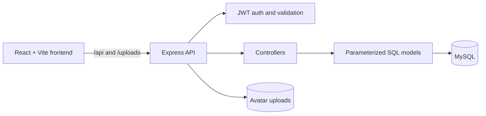
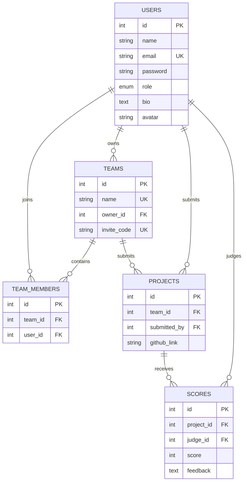

# Hackathon Management System

A full-stack application for organizing hackathons: participants form teams and submit projects, judges score submissions, and administrators manage the event.

## Features

- JWT-based registration, login, and role-based access (`admin`, `judge`, `participant`)
- Team creation and invite-code joining
- Project submissions with validated GitHub repository URLs
- Judge scoring and leaderboard
- Admin management of users, teams, projects, and scores
- Profile editing and avatar uploads
- API validation, request limits, security headers, request logs, and consistent JSON errors

## Tech stack

| Area | Technologies |
| --- | --- |
| Frontend | React 18, Vite, React Router, Axios |
| Backend | Node.js, Express, JWT, Zod, Multer |
| Database | MySQL 8, mysql2 |
| Deployment | Docker, Docker Compose, Nginx |

## Architecture



## Data model



## Setup without Docker

Requirements: Node.js 20+, MySQL 8+, and npm.

1. Create a MySQL database and user, then load `backend/database/schema.sql` (it creates/uses `hackathon_db`).
2. Copy `backend/.env.example` to `backend/.env`; set the database values, a long unique `JWT_SECRET`, and `CLIENT_URL` to the frontend origin. Set `ADMIN_EMAIL` and `ADMIN_PASSWORD` before seeding.
3. Run backend:

   ```powershell
   cd backend
   npm ci
   npm run db:migrate
   npm run db:seed
   npm run dev
   ```

4. In another terminal run frontend:

   ```powershell
   cd frontend
   npm ci
   Copy-Item .env.example .env
   npm run dev
   ```

The local Vite origin is `http://localhost:5173`; the API listens on `http://localhost:5000`.

## Setup with Docker

1. Copy `backend/.env.example` to `backend/.env`. Replace `JWT_SECRET`, `ADMIN_EMAIL`, and `ADMIN_PASSWORD` with development-only values.
2. From the repository root:

   ```sh
   docker compose up --build
   ```

Compose starts MySQL 8, loads `backend/database/schema.sql` on first database initialization, runs pending numbered migrations, then starts the API and frontend. Visit `http://localhost:8080`; the API is also available on port 5000.

3. Seed the configured administrator:

   ```sh
   docker compose exec backend npm run db:seed
   ```

The schema init script runs only when the MySQL data volume is empty. Later schema changes belong in `backend/database/migrations/` as numbered `.sql` files and are tracked in `schema_migrations`.

## Environment variables

| Variable | Required | Default | Description |
| --- | --- | --- | --- |
| `DB_HOST` | Yes | — | MySQL hostname |
| `DB_PORT` | Yes | — | MySQL port |
| `DB_USER` | Yes | — | MySQL username |
| `DB_PASSWORD` | No | empty | MySQL password |
| `DB_NAME` | Yes | — | Database name (`hackathon_db` for the supplied schema) |
| `JWT_SECRET` | Yes | — | Signing secret; use a long random value |
| `JWT_EXPIRES_IN` | No | `1d` | JWT lifetime |
| `PORT` | No | `5000` | Backend listen port |
| `CLIENT_URL` | No | `http://localhost:5173` | Comma-separated allowed browser origins |
| `TRUST_PROXY` | No | `false` | Express proxy trust setting; configure only for known reverse proxies |
| `ADMIN_EMAIL` | For seeding | — | Administrator email used by `npm run db:seed` |
| `ADMIN_PASSWORD` | For seeding | — | Administrator password used by `npm run db:seed` |
| `VITE_API_URL` | No | `/api` | Frontend API base URL; set to `http://localhost:5000/api` for local Vite |

## API endpoints

All protected routes require `Authorization: Bearer <JWT>`. Validation errors use `{ "message": "...", "errors": [{ "field": "...", "message": "..." }] }`.

| Method | Endpoint | Access | Purpose |
| --- | --- | --- | --- |
| `GET` | `/api/health` | Public | Health check |
| `POST` | `/api/auth/register` | Public, rate-limited | Register participant |
| `POST` | `/api/auth/login` | Public, rate-limited | Log in |
| `GET` | `/api/auth/me` | Authenticated | Current user |
| `GET`, `PUT` | `/api/profile` | Authenticated | Read/update profile |
| `PUT` | `/api/profile/password` | Authenticated | Change password |
| `POST` | `/api/profile/avatar` | Authenticated | Upload avatar (2 MB maximum) |
| `GET` | `/api/teams` | Authenticated | List teams |
| `POST` | `/api/teams/create` | Participant | Create team |
| `POST` | `/api/teams/join` | Participant | Join by invite code |
| `GET` | `/api/teams/my-team` | Authenticated | Current user's team |
| `GET` | `/api/teams/:id` | Authenticated | Team details |
| `GET` | `/api/projects` | Authenticated | List projects |
| `POST` | `/api/projects/submit` | Participant | Submit team project |
| `GET` | `/api/projects/my-project` | Participant | Current team's project |
| `GET` | `/api/projects/:id` | Authenticated | Project details |
| `DELETE` | `/api/projects/:id` | Admin | Delete project |
| `POST` | `/api/scores` | Judge | Score project (1–10) |
| `GET` | `/api/scores/project/:projectId` | Authenticated | Project scores |
| `GET` | `/api/scores` | Admin | All scores |
| `GET` | `/api/leaderboard` | Public | Leaderboard |
| `GET` | `/api/admin/stats` | Admin | Dashboard counts |
| `GET` | `/api/admin/users` | Admin | List users |
| `POST` | `/api/admin/users` | Admin | Create user |
| `DELETE` | `/api/admin/users/:id` | Admin | Delete user |
| `GET` | `/api/admin/teams` | Admin | List teams |
| `GET` | `/api/admin/projects` | Admin | List projects |
| `DELETE` | `/api/admin/projects/:id` | Admin | Delete project |
| `GET` | `/api/admin/scores` | Admin | List scores |

## Demo credentials

No default administrator or password is committed. Set `ADMIN_EMAIL` and `ADMIN_PASSWORD` in the backend environment, then run `npm run db:seed` (or `docker compose exec backend npm run db:seed`). Use those configured values to log in.

## Roadmap

- Add automated backend and frontend tests
- Add event configuration and registration windows
- Add team capacity and project submission deadlines
- Add observability and deployment-specific secret management
