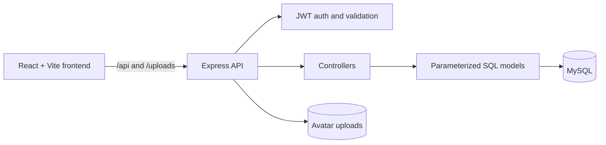
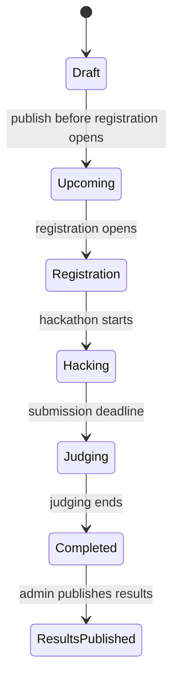
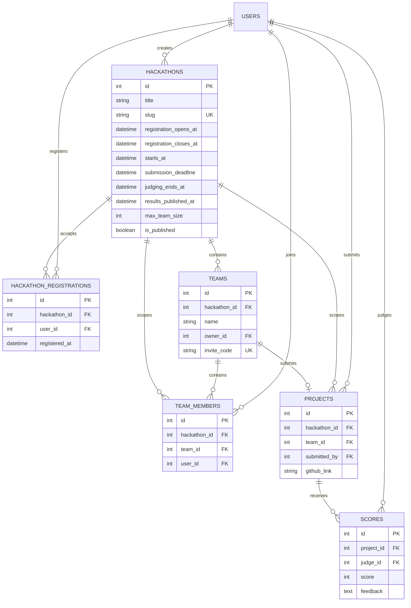

# Hackathon Management System

A multi-event platform for creating and running hackathons. Participants register per event, form event-scoped teams, submit projects, and follow published results. Judges score projects during the judging window, while administrators control event schedules, publication, users, and results.

## Features

- Multiple hackathons with independent schedules, registration, teams, projects, scores, and leaderboards
- Public event discovery with phase filters, search, pagination, event pages, and milestone countdowns
- Participant registration, per-event team creation/joining, project submission, and project editing
- Judge event selection and one-time project scoring during the judging phase
- Results hidden from public users until an administrator publishes them
- Admin event, user, team, project, score, and per-event statistics management
- JWT authentication, Zod request validation, rate limits, secure headers, and consistent JSON errors
- Avatar uploads and Docker Compose deployment

## Tech stack

| Area | Technologies |
| --- | --- |
| Frontend | React 18, Vite, React Router, Axios |
| Backend | Node.js, Express, JWT, Zod, Multer |
| Database | MySQL 8, mysql2 |
| Deployment | Docker, Docker Compose, Nginx |

## Architecture



## Hackathon lifecycle



Registration is separately allowed from `registration_opens_at` through `registration_closes_at` (inclusive); that window can overlap the hacking phase. Publishing/unpublishing results is an admin action available after the submission deadline.

## Data model



## Setup without Docker

Requirements: Node.js 20+, MySQL 8+, and npm.

1. Create a MySQL database and user, then load `backend/database/schema.sql`. It creates/uses `hackathon_db` and defines the pre-event baseline schema.
2. Copy `backend/.env.example` to `backend/.env`. Set database credentials, a long unique `JWT_SECRET`, and `CLIENT_URL`. Set `ADMIN_EMAIL` and `ADMIN_PASSWORD` for initial admin seeding.
3. Apply numbered migrations and seed the administrator:

   ```powershell
   cd backend
   npm ci
   npm run db:migrate
   npm run db:seed
   npm run dev
   ```

4. In another terminal, install and start the frontend:

   ```powershell
   cd frontend
   npm ci
   Copy-Item .env.example .env
   npm run dev
   ```

Vite runs at `http://localhost:5173`; the API listens at `http://localhost:5000`. The default frontend API path is `/api`; set `VITE_API_URL=http://localhost:5000/api` in `frontend/.env` when running Vite without a development proxy.

## Setup with Docker

1. Copy `backend/.env.example` to `backend/.env`. Replace `JWT_SECRET`, `ADMIN_EMAIL`, and `ADMIN_PASSWORD` with development-only values.
2. From the repository root:

   ```sh
   docker compose up --build
   ```

Compose starts MySQL 8, loads `backend/database/schema.sql` on first initialization, waits for the database health check, runs pending migrations, and then starts the API and frontend. Visit `http://localhost:8080`; the API is also available on port 5000.

3. Seed the configured administrator:

   ```sh
   docker compose exec backend npm run db:seed
   ```

`schema.sql` intentionally remains the baseline schema. Event tables and the event-scope backfill live in numbered migrations under `backend/database/migrations/`; the backend container runs `npm run db:migrate` before starting. The schema init script only runs when the MySQL data volume is empty.

## Environment variables

| Variable | Required | Default | Description |
| --- | --- | --- | --- |
| `DB_HOST` | Yes | — | MySQL hostname (`mysql` in Compose) |
| `DB_PORT` | Yes | — | MySQL port |
| `DB_USER` | Yes | — | MySQL username |
| `DB_PASSWORD` | No | empty | MySQL password |
| `DB_NAME` | Yes | — | Database name (`hackathon_db` for the supplied schema) |
| `JWT_SECRET` | Yes | — | Signing secret; use a long random value |
| `JWT_EXPIRES_IN` | No | `1d` | JWT lifetime |
| `PORT` | No | `5000` | Backend listen port |
| `CLIENT_URL` | No | `http://localhost:5173` | Comma-separated allowed browser origins |
| `TRUST_PROXY` | No | `false` | Express proxy trust setting; configure only for known reverse proxies |
| `ADMIN_EMAIL` | For admin seeding | — | Administrator email used by `npm run db:seed` |
| `ADMIN_PASSWORD` | For admin seeding | — | Administrator password used by `npm run db:seed` |
| `DEMO_PASSWORD` | For demo seeding | — | Shared password for demo judge and participant accounts; minimum 8 characters |
| `VITE_API_URL` | No | `/api` | Frontend API base URL |

## API endpoints

Protected routes require `Authorization: Bearer <JWT>`. Validation errors use `{ "message": "...", "errors": [{ "field": "...", "message": "..." }] }`.

| Method | Endpoint | Access | Purpose |
| --- | --- | --- | --- |
| `GET` | `/api/health` | Public | Health check |
| `POST` | `/api/auth/register` | Public, rate-limited | Register a participant |
| `POST` | `/api/auth/login` | Public, rate-limited | Log in |
| `GET` | `/api/auth/me` | Authenticated | Current user |
| `GET`, `PUT` | `/api/profile` | Authenticated | Read/update profile |
| `PUT` | `/api/profile/password` | Authenticated | Change password |
| `POST` | `/api/profile/avatar` | Authenticated | Upload avatar |
| `GET` | `/api/hackathons` | Public; admins also see drafts | Search, filter, paginate, and list counts/phases |
| `GET` | `/api/hackathons/me` | Authenticated | List the current user's registered events |
| `GET` | `/api/hackathons/:idOrSlug` | Public, draft hidden from non-admins | Event details and registration state |
| `POST`, `PUT`, `DELETE` | `/api/hackathons` and `/api/hackathons/:id` | Admin | Create, update, and delete an event |
| `PATCH` | `/api/hackathons/:id/publish` | Admin | Publish/unpublish an event |
| `PATCH` | `/api/hackathons/:id/results` | Admin | Publish/unpublish results after submissions close |
| `POST`, `DELETE` | `/api/hackathons/:id/register` | Participant | Register/unregister (cannot unregister while in a team) |
| `GET`, `POST` | `/api/hackathons/:hackathonId/teams` | Public list; registered participant create | List/create event teams |
| `POST` | `/api/hackathons/:hackathonId/teams/join` | Registered participant | Join by invite code |
| `GET` | `/api/hackathons/:hackathonId/teams/my-team` | Participant | Get this event's team |
| `GET` | `/api/hackathons/:hackathonId/projects` | Public | List event projects |
| `POST`, `PUT` | `/api/hackathons/:hackathonId/projects/submit` and `/api/hackathons/:hackathonId/projects/:id` | Registered participant | Submit/edit a team project |
| `GET` | `/api/hackathons/:hackathonId/projects/my-project` | Participant | Get this event's team project |
| `GET` | `/api/hackathons/:hackathonId/leaderboard` | Public after results; admins/judges always | Event standings |
| `GET` | `/api/teams/:id`, `/api/projects/:id` | Authenticated | Legacy-compatible resource detail |
| `POST` | `/api/scores` | Judge | Score a project during its event's judging phase |
| `GET` | `/api/scores/project/:projectId` | Authenticated | Project scores (hidden from participants until results publish) |
| `GET` | `/api/admin/stats?hackathon_id=:id` | Admin | Overall or per-event statistics |
| `GET`, `POST`, `DELETE` | `/api/admin/users` and `/api/admin/users/:id` | Admin | Manage users |
| `GET` | `/api/admin/teams`, `/api/admin/projects`, `/api/admin/scores` | Admin | Review resources |
| `DELETE` | `/api/admin/projects/:id` | Admin | Delete project |

## Business rules

- Draft events and their resources are hidden from non-admin users.
- Registration is accepted only from `registration_opens_at` through `registration_closes_at`, inclusive. Participants cannot unregister while they belong to an event team.
- Creating/joining a team requires event registration and is blocked after `submission_deadline`. Team capacity is checked under a row lock; a participant can belong to one team per event. Team names are unique within an event.
- Project submission/editing requires registration, team membership, and a time from `starts_at` through `submission_deadline`, inclusive. Each team can have one project per event.
- Scores are accepted only in the project's own hackathon during its judging phase, and a judge can score a project once.
- Public leaderboards and participant score details are hidden until results are published. Admins and judges can inspect live standings.
- Deleting an event with registrations returns `409` unless the administrator explicitly retries with `?force=true`; forced deletion cascades through event-owned teams, memberships, projects, and scores.
- Migration `001_hackathons.sql` checks for legacy duplicate projects per team and participants in multiple teams before applying unique constraints. Resolve any reported rows and rerun `npm run db:migrate`.

Useful curl checks (replace IDs/slugs, tokens, and invite codes with real values):

The demo seed supports the registration-window, deadline, unregister, deletion, and unpublished-results checks below. For full-team capacity, create an event currently in its registration or hacking window, register five participants, create a team with `max_team_size: 4`, then join the other three participants before trying with the fifth. For the scoring-window check, use a real project from a published event currently in hacking (not a project from the judging demo event).

```sh
# List published events, with phase/count fields
curl "http://localhost:5000/api/hackathons?phase=judging&page=1&limit=10"

# Register for an event (outside its registration window returns 403)
curl -X POST http://localhost:5000/api/hackathons/demo-upcoming/register \
  -H "Authorization: Bearer $PARTICIPANT_TOKEN"

# Join after the team deadline returns 403 (demo-judging is currently in judging)
curl -X POST http://localhost:5000/api/hackathons/demo-judging/teams/join \
  -H "Authorization: Bearer $PARTICIPANT_TOKEN" \
  -H "Content-Type: application/json" \
  -d '{"invite_code":"A1B2C3D4"}'

# A fifth registered participant joining a full team during its active team window returns 409
curl -X POST http://localhost:5000/api/hackathons/ACTIVE_HACKATHON/teams/join \
  -H "Authorization: Bearer $REGISTERED_PARTICIPANT_TOKEN" \
  -H "Content-Type: application/json" \
  -d '{"invite_code":"ACTUAL_TEAM_INVITE_CODE"}'

# Submitting outside starts_at..submission_deadline returns 403 before checking project duplication
curl -X POST http://localhost:5000/api/hackathons/demo-judging/projects/submit \
  -H "Authorization: Bearer $PARTICIPANT_TOKEN" \
  -H "Content-Type: application/json" \
  -d '{"title":"Demo","description":"Example","github_link":"https://github.com/example/demo"}'

# A project from an event currently in hacking returns 403 when scored
curl -X POST http://localhost:5000/api/scores \
  -H "Authorization: Bearer $JUDGE_TOKEN" \
  -H "Content-Type: application/json" \
  -d "{\"project_id\":${PROJECT_ID},\"score\":8,\"feedback\":\"Good work\"}"

# A participant with a team cannot unregister (demo participants are already in teams)
curl -X DELETE http://localhost:5000/api/hackathons/demo-judging/register \
  -H "Authorization: Bearer $PARTICIPANT_TOKEN"

# Deleting an event with registrations returns 409; use force only when intended
curl -X DELETE http://localhost:5000/api/hackathons/demo-judging \
  -H "Authorization: Bearer $ADMIN_TOKEN"
curl -X DELETE "http://localhost:5000/api/hackathons/demo-judging?force=true" \
  -H "Authorization: Bearer $ADMIN_TOKEN"

# Public leaderboard returns 403 until results are published
curl http://localhost:5000/api/hackathons/demo-judging/leaderboard
```

## Demo data and credentials

Run `npm run db:seed:demo` from `backend` after migrations. It creates a judging event with 12 participants, a judge, three teams, three projects, and scores, plus an upcoming event. It is idempotent for its demo slugs/accounts and refuses to run when `NODE_ENV=production`.

Set `DEMO_PASSWORD` (at least 8 characters) in `backend/.env` before seeding. The demo judge is `judge@demo.hackathon.local`; participant accounts are `participant01@demo.hackathon.local` through `participant12@demo.hackathon.local`. All use the configured `DEMO_PASSWORD`. The script never prints password values. The administrator is created separately from `ADMIN_EMAIL` and `ADMIN_PASSWORD` using `npm run db:seed`; no default administrator credentials are committed.

## Tests

```sh
cd backend
npm test
```

The Node test suite covers every lifecycle phase and timestamp boundary. Backend database migrations and business-rule curl examples require a reachable MySQL 8 database and seeded accounts.

## Roadmap

- Add broader API/database integration tests and browser end-to-end coverage
- Add event-specific email notifications and registration capacity controls
- Add richer judge rubrics and organizer audit history
- Add production deployment automation and observability
